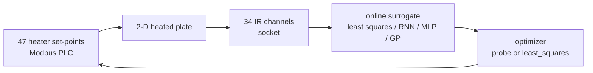

**English** | [简体中文](README.zh-CN.md)

<p align="center"></p>

# disk

### Closed-loop system identification on a 2-D heated plate

**A real thermal-control experiment: 47 heater set-points, 34 IR channels, and the inverse models that learned to steer one from the other.**

**Status: archive.** This is a sanitised snapshot, not a maintained project. The bench is gone, so nothing runs end-to-end; what survives is the control loop, the surrogate models and an analytical ground truth.

## Quick start

There is no end-to-end demo. The cleanest self-contained artifact is the analytical notebook:

```bash
python -m pip install numpy scipy matplotlib jupyter
jupyter lab closed_form.ipynb
```

The differentiable solver cell also needs `torch`. The notebook ships without stored outputs; some cells integrate over time and are slow. Run it cell by cell: the small `plt.imshow(o[-1])` cell is leftover scratch from the original session (`o` is never defined), so it raises `NameError` — the Green's-function cells around it are the content.

Every hardware script needs the original bench: a Modbus TCP PLC, an IR sensor socket, capture files (`ixy`, `ixy2`, `in.ixy`) and, for `__main__.py`, HALCON, the HIKROBOT MVS SDK, MinIO, MQTT and an ffmpeg build with `h264_qsv`. None of those are in this repository.

## What it can do now

- **Reconstruct the loop.** `disk.py` probes one heater at a time, fits a linear 47→34 response, and steps toward the target field.
- **Compare inversion strategies.** The archive keeps online least squares, direct `scipy.optimize.least_squares`, PyTorch RNN/LSTM surrogates, and scikit-learn experiments side by side.
- **Check learned models against analysis.** `closed_form.ipynb` gives the transient, steady-state and differentiable Green's-function solutions for the same diffusion-decay PDE.
- **Inspect the camera pipeline.** `__main__.py` shows HIKROBOT capture → HALCON inspection → MQTT job messages → MinIO upload.
- **Read the search, not just the result.** `Untitled3.ipynb` records an optimizer sweep: `dogbox` + 2-point + Huber was fastest per evaluation, while `trf` + 3-point + linear reached the lowest final loss.

## Architecture

The archive contains two independent stacks: the thermal loop and the camera/object-storage prototype.



| Area | Files | Role | Standalone? |
|---|---|---|---|
| Thermal control | `disk.py`, `disk0.py`, `disk1.py`, `disk2.py` | Online linear probing, RNN/LSTM surrogates, direct least-squares inversion. | No — needs the bench or capture files. |
| Analytical reference | `closed_form.ipynb` | Transient, steady-state and differentiable Green's-function solvers. | In principle — NumPy/SciPy/PyTorch only. |
| Research notes | `Untitled*.ipynb` | Plate simulator, optimizer sweep, PCA and scikit-learn surrogate experiments. | Mixed — some simulator cells run alone. |
| Camera pipeline | `tmpmv.py`, `__main__.py` | HIKROBOT GigE capture, HALCON inspection, MQTT job protocol, MinIO upload. | No — vendor SDK and services required. |
| Utilities | `nn.py`, `tmpmodbus.py` | Running normalization; scratch Modbus/sensor loop. | `nn.py` yes; `tmpmodbus.py` no. |
| Record | `docs/project-status.md` | Migration, sanitisation and licensing decisions. | — |

## How to develop

There is no build step, package metadata, lockfile or test suite. The repository is plain Python and notebooks.

- Use Python 3 and Jupyter.
- Start with the analytical notebook; it has no hardware dependencies.
- Do not import `disk*.py`, `tmpmodbus.py`, `tmpmv.py` or `__main__.py` casually: they open files, memmaps or hardware connections at import time.
- Versions were not recorded. This dependency list is reconstructed from imports.

| Dependency | Used by |
|---|---|
| Python 3 + Jupyter/IPython | notebooks |
| NumPy, SciPy | `disk.py`, `disk2.py`, notebooks |
| PyTorch | `disk0.py`, `disk1.py`, `tmpmodbus.py`, notebooks |
| scikit-learn | `disk.py`, `Untitled4/5.ipynb` |
| matplotlib | notebooks |
| `pymodbus` | `disk*.py`, `tmpmodbus.py`, `__main__.py` |
| `paho-mqtt` | `__main__.py` |
| `minio` | `__main__.py` |
| MVTec HALCON Python bindings | `__main__.py` (commercial, licensed) |
| HIKROBOT MVS SDK | `tmpmv.py`, `__main__.py` (external, not in this repo) |
| ffmpeg with `h264_qsv` | `__main__.py` |

There is no CI. Validate notebook cells and documentation links by hand.

## How to contribute

This is an archive, not a maintained product. Factual corrections are welcome. See [CONTRIBUTING.md](CONTRIBUTING.md) for the short policy. Do not submit hardware-specific patches you cannot test, and do not reintroduce redacted hosts or credentials.

## Roadmap

### Implemented

- Sanitised, licensed and documented archive.
- Complete control-loop code: online linear probing, RNN/LSTM surrogates, direct least-squares inversion.
- Analytical Green's-function notebook with transient, steady-state and differentiable solvers.
- Camera/object-storage prototype preserved with vendor SDK boundaries stated.
- Migration record covering removals, redactions and earlier documentation corrections.

### Planned

- No feature work. This repository is closed as an archive.
- Maintenance only: fix factual errors and keep the record accurate.
- Owner action, not a code change: if the removed MinIO key pair is still live, rotate it.

## Future vision

This repository is not trying to become a framework. Its long-term value is as a compact reference for inverting a real diffusion plant when the forward model is expensive and the measurements are noisy: the analytical check, the probing controller, the learned surrogates and the optimizer sweep are all in one place. If the bench is ever revived, the natural next step would be a small, import-safe package around the closed-form solver with bench-free tests. That is a separate project, not a promise here.

## Sanitisation

This tree was migrated from a private archive. No credential value survives here.

> **Credential warning:** `__main__.py` previously contained a literal MinIO access-key/secret-key pair. It was removed and replaced with `MINIO_ACCESS_KEY` / `MINIO_SECRET_KEY` environment lookups. If you own the original deployment, rotate that key pair.

Internal hostnames and private IPs were replaced with `<REDACTED:...>` placeholders in `disk.py`, `disk0.py`, `disk1.py`, `disk2.py`, `tmpmodbus.py` and `Untitled-Copy1.ipynb`. Loopback references use `localhost`; no real internal address remains. Employer-internal MQTT topic names were genericised. The five generated HIKROBOT MVS binding files that shipped with the original tree were removed as third-party code.

## License

Owner-authored code is [AGPL-3.0-only](LICENSE). The HIKROBOT MVS bindings are third-party, are not included, and remain under the vendor's terms; nothing here grants rights to redistribute them. HALCON is commercial software and is not included.

For the full migration and removal record, see [`docs/project-status.md`](docs/project-status.md).
