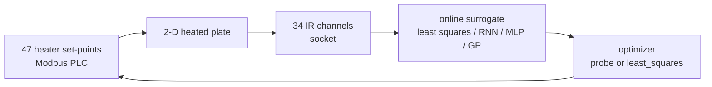

<p align="center"></p>

# disk

**A real closed-loop thermal-control experiment: 47 heater set-points, 34 IR channels, and the inverse models that learned to steer one from the other.**

**Status: archive.** This is a sanitised snapshot, not a maintained project. The bench is gone, so nothing here runs end-to-end; the value is the control loop, the surrogate models and an analytical ground truth, kept together as a record.

## Why keep it

This is not a simulation with a known plant. A 2-D heated plate is driven through Modbus set-points and measured through an IR sensor socket, and its 47→34 response is learned from the hardware itself. The repository contains the whole attempt: online least squares, neural surrogates, direct optimisation, and the analytical solution used as a reference.

That makes it useful as a worked example of inverting a diffusion plant when the forward model is expensive and the measurements are noisy — including the paths that did not become the final answer. The notes preserve the search itself: `Untitled3.ipynb` compares `least_squares` configurations and records `dogbox` + 2-point + Huber as the fastest per evaluation, and `trf` + 3-point + linear as the lowest final loss.



## What is inside

| Path | What it is | Runs without the bench? |
|---|---|---|
| `disk.py` | Online controller: probes one heater at a time, fits a linear 47→34 model, steps toward the target field. | **No** — opens `in.ixy` and connects to the PLC/sensor at import. |
| `disk0.py` | PyTorch RNN surrogate trained online against the memmap capture `ixy`; writes set-points back to the plate. | No |
| `disk1.py` | LSTM surrogate trained against a simulated plate; the hardware calls are commented out. | No — still needs `ixy`. |
| `disk2.py` | Direct `scipy.optimize.least_squares` over the 47 inputs, with cached measurements. | No |
| `nn.py` | Tiny running-normalisation helper used by the training loops. | Yes — importable on its own. |
| `tmpmodbus.py`, `tmpmv.py` | Scratch hardware probes (Modbus loop, HIKROBOT GigE capture to stdout). | No |
| `__main__.py` | HALCON inspection pipeline: camera → ffmpeg/QSV → MQTT job protocol → MinIO upload. | No — needs HALCON, MVS, a config, and running services. |
| `closed_form.ipynb` | Transient and steady-state Green's-function solvers, plus a differentiable PyTorch version. | **Yes, in principle** — NumPy/SciPy/PyTorch only; no stored outputs. |
| `Untitled*.ipynb` | Research notes: plate simulator, `least_squares` parameter sweep, PCA and scikit-learn surrogate experiments. | Mixed — some simulator cells are standalone; data cells need `ixy` / `ixy2`. |
| `docs/project-status.md` | Migration, sanitisation and licensing record. | — |
| `LICENSE` | AGPL-3.0-only. | — |

No capture files (`.xlsx`, `.csv`, images, `.mp4`, `ixy`, `ixy2`, `in.ixy`) are included. The scripts that read them cannot be re-run without the original bench.

## Running it

There is no zero-to-running path. Every hardware script expects a private bench network, a Modbus TCP PLC, an IR sensor socket, the capture files above and — for `__main__.py` — MVTec HALCON, the HIKROBOT MVS SDK, a MinIO server, an MQTT broker and an ffmpeg build with `h264_qsv`. None of those are in this repository.

The one artifact worth opening is `closed_form.ipynb`:

```bash
python -m pip install numpy scipy matplotlib jupyter
jupyter lab closed_form.ipynb
```

It solves the same diffusion-decay PDE analytically instead of learning it. The notebook ships without stored outputs; work through it from the top. Some cells are deliberately expensive (the transient solver integrates over time), so expect to wait. The differentiable cell also needs `torch`.

The analytical API, defined in that notebook, has this shape:

```python
sources = [(0.0, 0.0, 100.0, 1.0), (1.0, 0.0, 50.0, 0.5)]  # x, y, T, coupling
T = temperature_steady(0.1, 0.0, sources, kappa=1e-4, h_env=1e-3)
```

`temperature_steady` returns the steady-state temperature at the query point with both thermostats coupled; `temperature` does the transient version, and `temperature_steady_pt` is the differentiable PyTorch equivalent.

## Dependencies

Versions were not recorded and there is no lockfile. This list is reconstructed from imports.

| Dependency | Used by |
|---|---|
| Python 3 + Jupyter/IPython | notebooks |
| NumPy, SciPy | `disk.py`, `disk2.py`, notebooks |
| PyTorch | `disk0.py`, `disk1.py`, `tmpmodbus.py`, notebooks |
| scikit-learn | `disk.py`, `Untitled4/5.ipynb` |
| matplotlib | notebooks |
| `pymodbus` | `disk*.py`, `tmpmodbus.py`, `__main__.py` |
| `paho-mqtt` | `__main__.py` |
| `minio` | `__main__.py` |
| MVTec HALCON Python bindings | `__main__.py` (commercial, licensed) |
| HIKROBOT MVS SDK | `tmpmv.py`, `__main__.py` (external, not in this repo) |
| ffmpeg with `h264_qsv` | `__main__.py` |

## Sanitisation

This tree was migrated from a private archive. No credential value survives here.

> **Credential warning:** `__main__.py` previously contained a literal MinIO access-key/secret-key pair. It was removed and replaced with `MINIO_ACCESS_KEY` / `MINIO_SECRET_KEY` environment lookups. If you own the original deployment, rotate that key pair.

Internal hostnames and private IPs were replaced with `<REDACTED:...>` placeholders in `disk.py`, `disk0.py`, `disk1.py`, `disk2.py`, `tmpmodbus.py` and `Untitled-Copy1.ipynb`. Loopback references use `localhost`; no real internal address remains. Employer-internal MQTT topic names were genericised. The five generated HIKROBOT MVS binding files that shipped with the original tree were removed as third-party code.

## Status

| Done | Not done | Next |
|---|---|---|
| Sanitised, licensed, documented; analytical reference preserved. | No runnable demo, no tests, no packaging, no data, no dependency lockfile. | Nothing planned — this is an archive. |

## Contributing

There is no roadmap and no support. If you find a factual error in this record, open an issue. Do not send hardware-specific patches you cannot test.

## License

Owner-authored code is [AGPL-3.0-only](LICENSE). The HIKROBOT MVS bindings are third-party, are not included, and remain under the vendor's terms; nothing here grants rights to redistribute them. HALCON is commercial software and is not included.

For the full migration and removal record, see [`docs/project-status.md`](docs/project-status.md).
