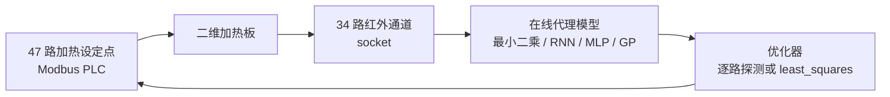

[English](README.md) | **简体中文**

<p align="center"></p>

# disk

### 二维热板上的闭环系统辨识

**一个真实的闭环热控实验：47 路加热设定点、34 路红外测温通道，以及学会从前者反推后者的逆模型。**

**状态：归档。** 这是一份脱敏快照，不是持续维护的项目。实验台已经不在，因此没有能够端到端运行的路径；留下来的，是控制回路、代理模型和一份解析基准。

## 快速开始

这里没有端到端演示。唯一能独立打开的产物是解析解笔记本：

```bash
python -m pip install numpy scipy matplotlib jupyter
jupyter lab closed_form.ipynb
```

可微求解器单元还需要 `torch`。笔记本没有预存输出；部分单元需要对时间做积分，会比较慢。

所有硬件脚本都依赖原来的实验台：Modbus TCP PLC、红外传感器 socket、采集文件（`ixy`、`ixy2`、`in.ixy`）；`__main__.py` 还需要 HALCON、HIKROBOT MVS SDK、MinIO、MQTT，以及带 `h264_qsv` 的 ffmpeg。这些都不在仓库里。

## 现在能做什么

- **还原控制回路。** `disk.py` 每次只探测一路加热器，拟合 47→34 的线性响应，再一步步逼近目标温度场。
- **比较不同的反演思路。** 仓库把在线最小二乘、`scipy.optimize.least_squares` 直接优化、PyTorch RNN/LSTM 代理模型和 scikit-learn 实验放在一起。
- **用解析解校验学习模型。** `closed_form.ipynb` 针对同一个扩散-衰减 PDE，给出瞬态、稳态和可微的格林函数解。
- **查看相机链路。** `__main__.py` 展示了 HIKROBOT 采集 → HALCON 检测 → MQTT 任务消息 → MinIO 上传的流程。
- **看到搜索过程，而不只是结论。** `Untitled3.ipynb` 记录了一次优化器参数扫描：`dogbox` + 2-point + Huber 每次评估下降最快，`trf` + 3-point + linear 最终损失最低。

## 架构

仓库里有两套彼此独立的东西：热控回路，以及相机/对象存储原型。



| 区域 | 文件 | 作用 | 能否独立运行？ |
|---|---|---|---|
| 热控 | `disk.py`、`disk0.py`、`disk1.py`、`disk2.py` | 在线线性探测、RNN/LSTM 代理模型、最小二乘直接反演。 | 否——需要实验台或采集文件。 |
| 解析基准 | `closed_form.ipynb` | 瞬态、稳态和可微的格林函数求解器。 | 理论上可以——只依赖 NumPy/SciPy/PyTorch。 |
| 研究笔记 | `Untitled*.ipynb` | 热板仿真、优化器扫描、PCA 和 scikit-learn 代理模型实验。 | 部分可以——有些仿真单元能单独运行。 |
| 相机链路 | `tmpmv.py`、`__main__.py` | HIKROBOT GigE 采集、HALCON 检测、MQTT 任务协议、MinIO 上传。 | 否——需要厂商 SDK 和服务。 |
| 工具 | `nn.py`、`tmpmodbus.py` | 滑动归一化；临时的 Modbus/传感器循环。 | `nn.py` 可以；`tmpmodbus.py` 不行。 |
| 记录 | `docs/project-status.md` | 迁移、脱敏和许可决策。 | — |

## 如何开发

仓库没有构建步骤、包元数据、锁文件或测试套件，只有普通 Python 和 Jupyter 笔记本。

- 使用 Python 3 和 Jupyter。
- 先从解析解笔记本开始；它不依赖硬件。
- 不要随手 `import` `disk*.py`、`tmpmodbus.py`、`tmpmv.py` 或 `__main__.py`：它们在导入时就会打开文件、memmap 或硬件连接。
- 当时没有记录版本号。下面的依赖表是从 import 反推出来的。

| 依赖 | 使用位置 |
|---|---|
| Python 3 + Jupyter/IPython | 笔记本 |
| NumPy、SciPy | `disk.py`、`disk2.py`、笔记本 |
| PyTorch | `disk0.py`、`disk1.py`、`tmpmodbus.py`、笔记本 |
| scikit-learn | `disk.py`、`Untitled4/5.ipynb` |
| matplotlib | 笔记本 |
| `pymodbus` | `disk*.py`、`tmpmodbus.py`、`__main__.py` |
| `paho-mqtt` | `__main__.py` |
| `minio` | `__main__.py` |
| MVTec HALCON Python 绑定 | `__main__.py`（商业软件，需授权） |
| HIKROBOT MVS SDK | `tmpmv.py`、`__main__.py`（外部依赖，不在本仓库） |
| 带 `h264_qsv` 的 ffmpeg | `__main__.py` |

仓库没有 CI。请手动检查笔记本单元和文档链接。

## 如何贡献

这是一个归档，不是持续维护的产品。欢迎指出事实错误；简短约定见 [CONTRIBUTING.md](CONTRIBUTING.md)。请不要提交自己无法在硬件上验证的补丁，也不要把已经脱敏的主机名或凭据加回来。

## 路线图

### 已实现

- 完成脱敏、许可和文档整理的归档。
- 完整的控制回路代码：在线线性探测、RNN/LSTM 代理模型、最小二乘直接反演。
- 解析解笔记本：瞬态、稳态和可微三种格林函数求解器。
- 保留相机/对象存储原型，并写明厂商 SDK 的边界。
- 迁移记录：删除项、脱敏项，以及早期文档的修正。

### 计划中

- 没有功能开发计划。这个仓库已经作为归档收尾。
- 只做维护：修正事实错误，保持记录准确。
- 所有者待办，不是代码改动：如果删除的 MinIO 密钥仍然有效，请轮换它。

## 未来愿景

这个仓库不打算变成框架。它的长期价值是一份紧凑的参考：当正向模型昂贵、测量有噪声时，如何反演一个真实的扩散系统。解析校验、探测式控制器、学习到的代理模型和优化器扫描都放在同一个地方。如果实验台哪天重新启用，自然的下一步是把闭式解做成一个小而安全的包，并补上不依赖实验台的测试。那是另一个项目，不是这里的承诺。

## 脱敏说明

本仓库从私有归档迁移而来，不保留任何凭据值。

> **凭据警告：** `__main__.py` 里曾经有一个明文 MinIO access-key/secret-key 对。它已被删除，改成 `MINIO_ACCESS_KEY` / `MINIO_SECRET_KEY` 环境变量。如果你拥有原来的部署，请轮换这组密钥。

`disk.py`、`disk0.py`、`disk1.py`、`disk2.py`、`tmpmodbus.py` 和 `Untitled-Copy1.ipynb` 中的内部主机名和私有 IP 已替换为 `<REDACTED:...>` 占位符。回环地址写作 `localhost`，没有留下真实的内网地址。雇主内部的 MQTT topic 名称已泛化。随原始目录附带的五个 HIKROBOT MVS 生成绑定文件属于第三方代码，已在发布前删除。

## 许可

作者编写的代码采用 [AGPL-3.0-only](LICENSE)。HIKROBOT MVS 绑定属于第三方，未包含在本仓库中，仍受厂商条款约束；本仓库不授予再分发这些文件的权利。HALCON 是商业软件，也未包含在内。

完整的迁移和删除记录见 [`docs/project-status.md`](docs/project-status.md)。
